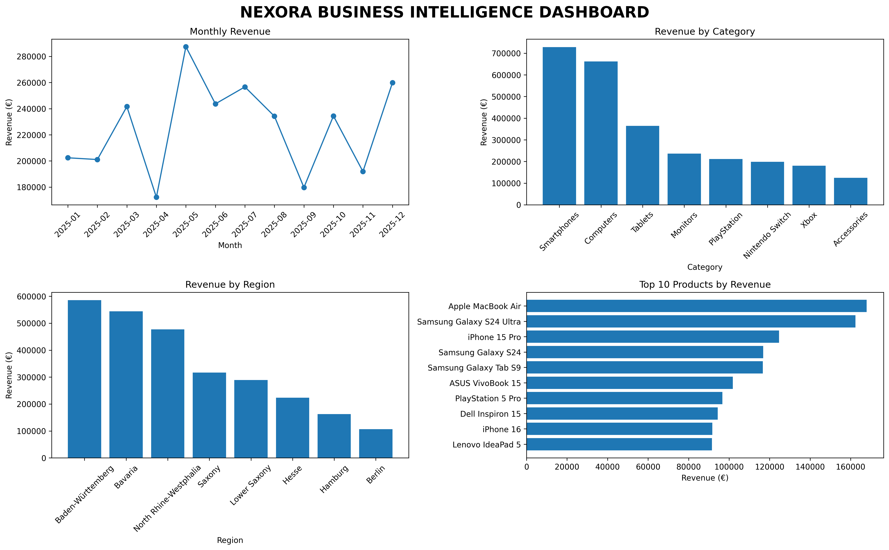

# NEXORA — Business Intelligence & Data Analytics

Nexora is a fictional German consumer electronics retailer created as a Business Intelligence and Data Analytics portfolio project.

The project analyzes 2025 sales data to identify revenue trends, profitability, high-performing products, customer behavior and geographic performance.

---

## 📊 Project Overview

The goal of this project is to simulate a real-world business analysis task where management needs data-driven answers to improve sales and profitability.

The analysis covers:

* Revenue
* Profit
* Profit margins
* Product performance
* Category performance
* Customer behavior
* City performance
* Regional performance
* Monthly sales trends

---

## 🛠️ Technologies

* Python
* Pandas
* Matplotlib
* SQL
* SQLite
* Git
* GitHub
* VS Code

---

## 📁 Dataset

The project contains three main datasets.

### Customers

500 fictional customers from different German cities and regions.

### Products

51 consumer electronics products across:

* Computers
* Tablets
* Smartphones
* Monitors
* Nintendo Switch
* PlayStation
* Xbox
* Accessories

### Sales

2,000 fictional sales transactions covering 2025.

---

## 📈 Key Business KPIs

| KPI              |     Result |
| ---------------- | ---------: |
| Total Orders     |      2,000 |
| Total Items Sold |      6,071 |
| Total Revenue    | €2,705,320 |
| Total Cost       | €2,041,047 |
| Total Profit     |   €664,273 |
| Profit Margin    |     24.55% |
| Customers        |        500 |
| Products         |         51 |

---

## 🏆 Key Findings

### Smartphones Lead Revenue

Smartphones generated the highest revenue of all product categories.

**Revenue: €728,335**

### Accessories Have the Highest Profit Margin

Accessories generated the highest profit margin.

**Profit Margin: 38.55%**

### Freiburg Leads City Performance

Freiburg generated the highest revenue among the analyzed cities.

**Revenue: €179,973**

### Baden-Württemberg Leads Regionally

Baden-Württemberg generated the highest regional revenue.

**Revenue: €585,445**

### May Was the Strongest Month

May 2025 generated the highest monthly revenue.

**Revenue: €287,416**

---

## 📊 Dashboard

The project includes a business dashboard created with Python and Matplotlib.

The dashboard contains:

* Monthly revenue
* Revenue by category
* Revenue by region
* Top 10 products



---

## 🔎 Analysis Workflow

The project follows this workflow:

```text
Data Generation
       ↓
CSV Datasets
       ↓
Python / Pandas
       ↓
Exploratory Analysis
       ↓
SQLite Database
       ↓
SQL Analysis
       ↓
Data Visualization
       ↓
Business Insights
       ↓
Management Recommendations
```

---

##  Author

**Hussein Monem**

Computer Science student focused on **Business Analysis, Business IT, data analytics, process improvement, and data-driven decision support**.
